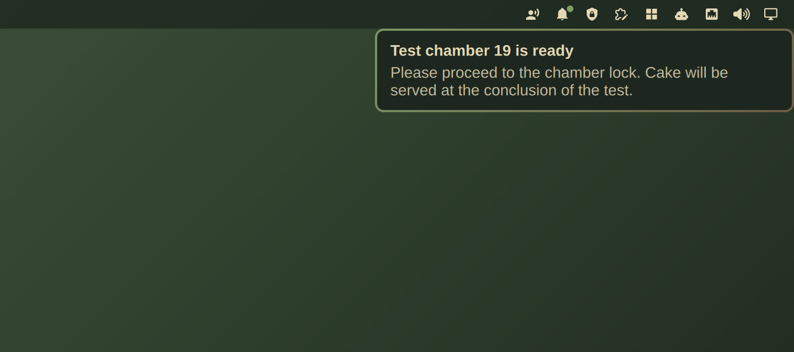

# GLaDOS Voice

An [Omarchy](https://omarchy.org) plugin that reads your desktop notifications
aloud in GLaDOS's voice, using [GLaDOS-TTS](https://github.com/nimaid/GLaDOS-TTS).
A small icon in the bar shows that she is listening; click it to mute her.



## Install

```bash
omarchy pkg add uv
omarchy plugin add https://github.com/smolamSK/omarchy-glados-voice.git --enable
```

The first time it is enabled, the plugin downloads the voice (about 250 MB, see
[What it downloads](#what-it-downloads)). The icon is dimmed and its tooltip
says *downloading voice…* until it is ready, and a notification tells you when
it is done. After that it starts in a couple of seconds.

### Requirements

- `uv`, to create a private Python 3.12 environment (`omarchy pkg add uv`)
- `git`, `curl`, `sha256sum`, `setpriv` and PipeWire's `pw-play`, all already
  on Omarchy
- Network access the first time it runs
- Roughly 350 MB of RAM while enabled; nothing while disabled

## Using it

| | |
| --- | --- |
| **Click the icon** | Mute or unmute. Muting keeps the voice loaded, so unmuting is instant. |
| **Do Not Disturb** | Also silences GLaDOS. |
| **Lock the screen** | GLaDOS falls silent within about a second and stays quiet while it is locked. Notifications that arrive meanwhile are not read later. |
| **Disable the plugin** | `omarchy plugin disable io.github.smolamsk.glados-voice` stops the reader completely. |

To mute from a key, add this to `~/.config/hypr/bindings.lua`:

```lua
o.bind("SUPER + CTRL + G", "Mute GLaDOS voice",
  os.getenv("HOME") .. "/.config/omarchy/plugins/io.github.smolamsk.glados-voice/bin/glados-voice mute toggle")
```

`bin/glados-voice` also has `mute on`, `mute off`, `status` (exit 0 when
listening) and `test` (sends a sample notification).

Notifications are read as *title, then message*, with formatting removed. They
are read in order, at most five waiting at a time; the same text arriving
twice within five seconds is read once. Muting, Do Not Disturb or locking the
screen stops her mid-sentence and drops every notification still waiting. This
is checked every quarter of a second while she has anything to say.

## Settings

Open the bar settings and pick GLaDOS Voice.

| Setting | Default | |
| --- | --- | --- |
| Read the message text | on | Off reads only the title. |
| Longest message to read | 250 | Characters; longer ones are cut at a word. |
| Never read these apps | (empty) | Comma-separated app names, e.g. `Spotify, Slack`. |
| Read while the screen is locked | off | On reads notifications even while the screen is locked. |

## How it works

Omarchy's own notification service keeps showing notifications; this plugin
only listens. `Service.qml` runs `bin/glados-voice run`, which starts
`bin/glados_voice.py`. That script becomes a passive D-Bus monitor for
`org.freedesktop.Notifications.Notify` calls on your session bus, speaks each
one with GLaDOS-TTS and plays it with `pw-play`. Nothing leaves your machine:
speech is generated locally with ONNX Runtime on the CPU.

Before and while speaking, it asks Omarchy's `omarchy-hyprland-session-locked`
(the same check Omarchy's lock screen uses) whether Hyprland holds a session
lock. If the answer is anything but a clear "unlocked", GLaDOS stays quiet.
Omarchy's lock screen takes about half a second to hand Hyprland the lock, so
she can still be heard for up to about a second after you lock.

### What it downloads

Everything goes into `~/.local/share/glados-voice/`, apart from what `uv`
manages itself (see below). No sudo, no system packages:

- [GLaDOS-TTS](https://github.com/nimaid/GLaDOS-TTS), cloned and checked out at
  the pinned commit `27b1ae489acc4404f9248a85361cdaf47d1b433f`
- A Python 3.12 virtual environment created by `uv`, with `onnxruntime`,
  `numpy`, `num2words`, `jeepney` and their dependencies installed from PyPI at
  the exact versions and SHA-256 hashes in [`requirements.txt`](requirements.txt).
  Only prebuilt wheels are used; nothing is built from source.
  If no Python 3.12 is available, `uv` downloads one into its own folder
  (`~/.local/share/uv/python/`), and it caches packages in `~/.cache/uv/`. The
  Python 3.12 patch release is whichever one `uv` finds or picks.
- The voice models `glados.onnx` and `phomenizer_en.onnx` from the
  [dnhkng/GlaDOS 0.1 release](https://github.com/dnhkng/GlaDOS/releases/tag/0.1),
  each checked against a pinned SHA-256 before use

Settings, the mute flag and a log (`daemon.log`) live in
`~/.local/state/glados-voice/`, which is readable only by you. The log records
which app sent a notification, never its text.

## Remove

```bash
omarchy plugin remove io.github.smolamsk.glados-voice
rm -rf ~/.local/share/glados-voice ~/.local/state/glados-voice
```

Also remove the keybinding if you added one. `uv`'s Python and cache
(`~/.local/share/uv/`, `~/.cache/uv/`) may be shared with other tools, so
remove them only if nothing else uses `uv`.

## Credits

- [nimaid/GLaDOS-TTS](https://github.com/nimaid/GLaDOS-TTS) (MIT): the
  text-to-speech package
- [dnhkng/GlaDOS](https://github.com/dnhkng/GlaDOS) (MIT): the voice and
  phonemizer models

This repository contains no model files; they are downloaded from their
upstream release. GLaDOS and Portal are trademarks of Valve Corporation. This
project is not affiliated with or endorsed by Valve.

## License

[MIT](LICENSE)
